#
> :warning: **Warning**
> 
> The code samples contain multiple ways and patterns to do things and not always be considered best practices or recommended for all situations.
#

# Database Centric vs Domain Centric Architecture 
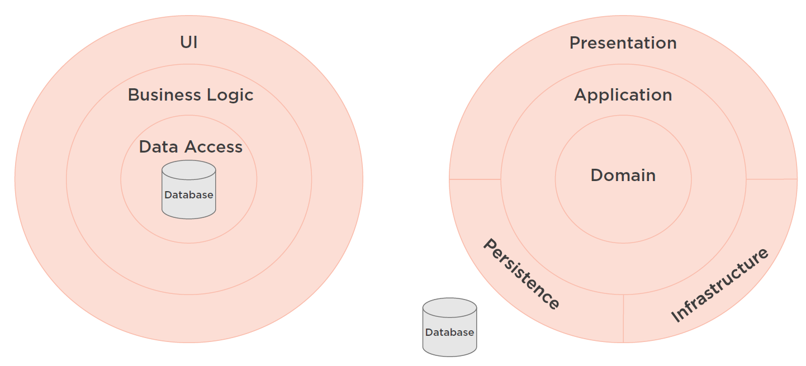

[*(open on draw.io)*](https://www.draw.io/#Uhttps%3A%2F%2Fraw.githubusercontent.com%2Fphongnguyend%2FPractical.CleanArchitecture%2Fmaster%2Fdocs%2Fimgs%2Fdatabase-centrics-vs-domain-centric-architecture.drawio)

# Hexagonal Architecture
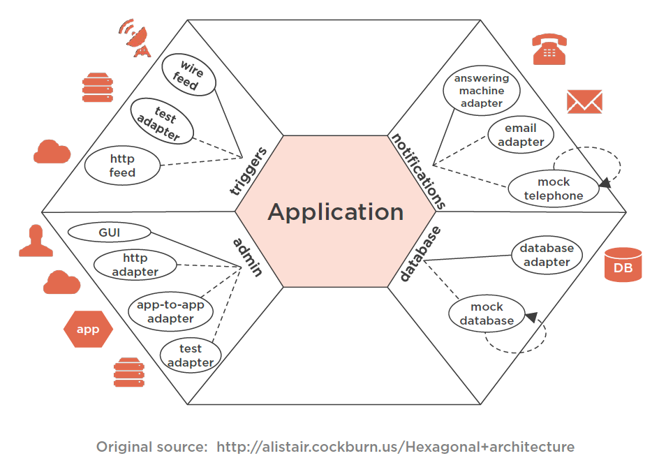

[*(open on draw.io)*](https://www.draw.io/#Uhttps%3A%2F%2Fraw.githubusercontent.com%2Fphongnguyend%2FPractical.CleanArchitecture%2Fmaster%2Fdocs%2Fimgs%2Fhexagonal-architecture.drawio)

# Onion Architecture
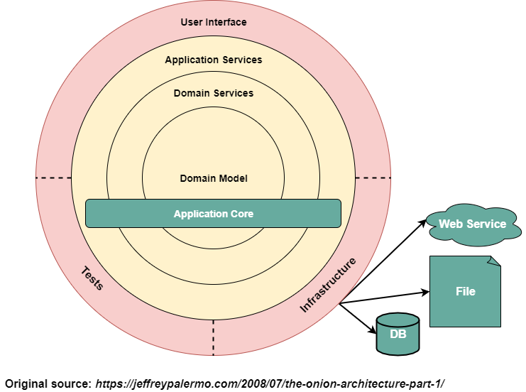

[*(open on draw.io)*](https://www.draw.io/#Uhttps%3A%2F%2Fraw.githubusercontent.com%2Fphongnguyend%2FPractical.CleanArchitecture%2Fmaster%2Fdocs%2Fimgs%2Fonion-architecture.drawio)

# The Clean Architecture
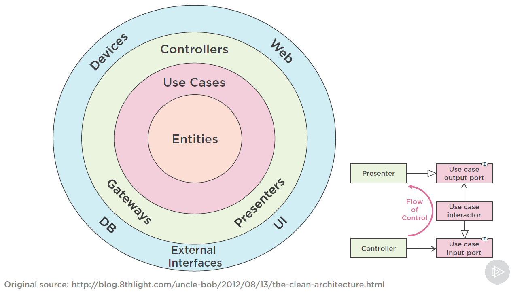

[*(open on draw.io)*](https://www.draw.io/#Uhttps%3A%2F%2Fraw.githubusercontent.com%2Fphongnguyend%2FPractical.CleanArchitecture%2Fmaster%2Fdocs%2Fimgs%2Fthe-clean-architecture.drawio)

# Classic Three-layer Architecture
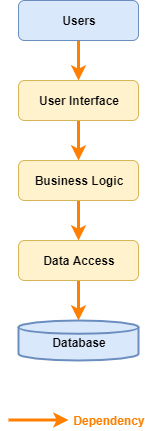

[*(open on draw.io)*](https://www.draw.io/#Uhttps%3A%2F%2Fraw.githubusercontent.com%2Fphongnguyend%2FPractical.CleanArchitecture%2Fmaster%2Fdocs%2Fimgs%2Fclassic-three-layer-architecture.drawio)

# Modern Four-layer Architecture
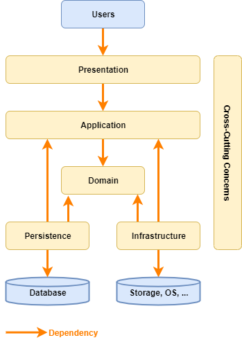

[*(open on draw.io)*](https://www.draw.io/#Uhttps%3A%2F%2Fraw.githubusercontent.com%2Fphongnguyend%2FPractical.CleanArchitecture%2Fmaster%2Fdocs%2Fimgs%2Fmodern-four-layer-architecture.drawio)

# Layer Dependencies
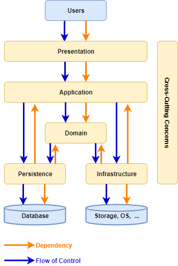

[*(open on draw.io)*](https://www.draw.io/#Uhttps%3A%2F%2Fraw.githubusercontent.com%2Fphongnguyend%2FPractical.CleanArchitecture%2Fmaster%2Fdocs%2Fimgs%2Flayer-dependencies.drawio)

# Layer Examples
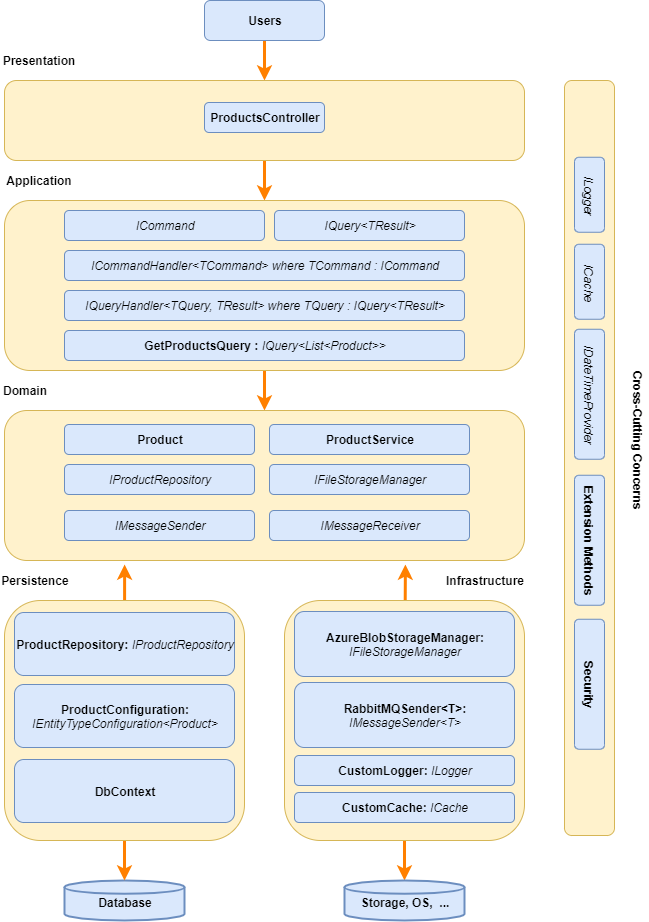

[*(open on draw.io)*](https://www.draw.io/#Uhttps%3A%2F%2Fraw.githubusercontent.com%2Fphongnguyend%2FPractical.CleanArchitecture%2Fmaster%2Fdocs%2Fimgs%2Flayer-examples.drawio)

# Testing Pyramid
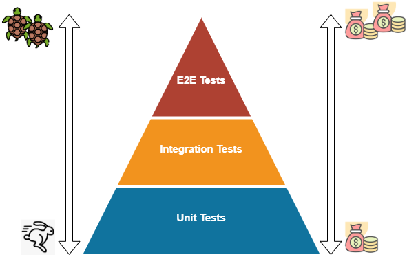
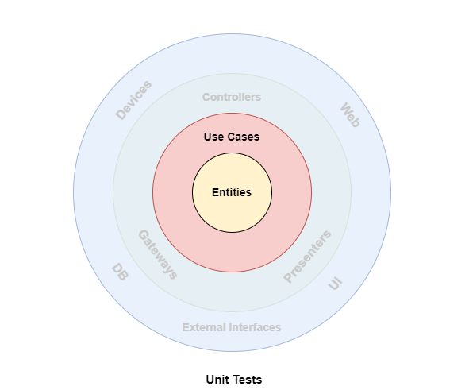
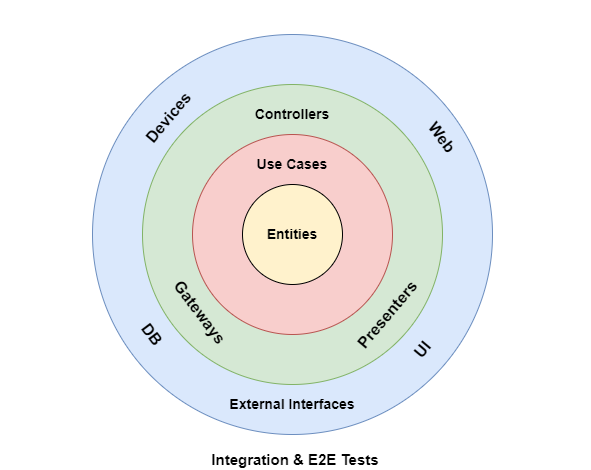

[*(open on draw.io)*](https://www.draw.io/#Uhttps%3A%2F%2Fraw.githubusercontent.com%2Fphongnguyend%2FPractical.CleanArchitecture%2Fmaster%2Fdocs%2Fimgs%2Ftesting-pyramid.drawio)

# Vertical Slice Architecture (Modular Monolith)
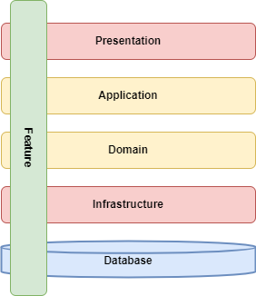

[*(open on draw.io)*](https://www.draw.io/#Uhttps%3A%2F%2Fraw.githubusercontent.com%2Fphongnguyend%2FPractical.CleanArchitecture%2Fmaster%2Fdocs%2Fimgs%2Fvertical-slice-architecture.drawio)

# Solution Structure
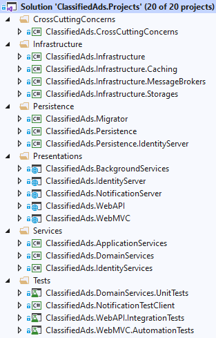

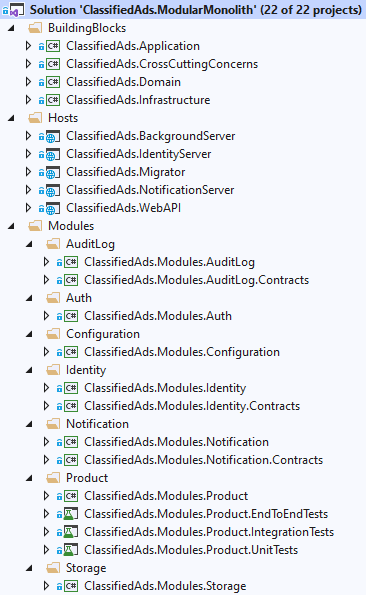

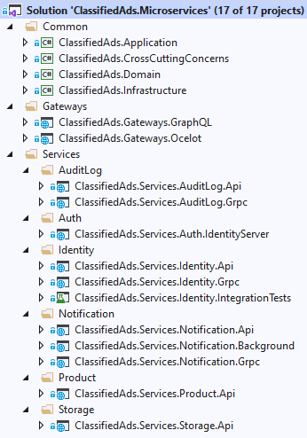

# How to Run:
## Update Configuration
<details>
  <summary><b>Additional Configuration Sources</b></summary>
  
  - Open [ClassifiedAds.WebMVC/appsettings.json](/src/Monolith/ClassifiedAds.WebMVC/appsettings.json) and jump to **ConfigurationSources** section.
    ```js
    "ConfigurationSources": {
      "SqlServer": {
        "IsEnabled": false,
        "ConnectionString": "Server=127.0.0.1;Database=ClassifiedAds;User Id=sa;Password=sqladmin123!@#",
        "SqlQuery": "select [Key], [Value] from ConfigurationEntries"
      },
      "AzureKeyVault": {
        "IsEnabled": false,
        "VaultName": "https://xxx.vault.azure.net/"
      }
    },
    ```

  - Get from Sql Server database:
    ```js
    "ConfigurationSources": {
      "SqlServer": {
        "IsEnabled": true,
        "ConnectionString": "Server=127.0.0.1;Database=ClassifiedAds;User Id=sa;Password=sqladmin123!@#",
        "SqlQuery": "select [Key], [Value] from ConfigurationEntries"
      },
    },
    ```

  - Get from Azure Key Vault:
    ```js
    "ConfigurationSources": {
      "AzureKeyVault": {
        "IsEnabled": true,
        "VaultName": "https://xxx.vault.azure.net/"
      }
    },
    ```

  - Use Both:
    ```js
    "ConfigurationSources": {
      "SqlServer": {
        "IsEnabled": true,
        "ConnectionString": "Server=127.0.0.1;Database=ClassifiedAds;User Id=sa;Password=sqladmin123!@#",
        "SqlQuery": "select [Key], [Value] from ConfigurationEntries"
      },
      "AzureKeyVault": {
        "IsEnabled": true,
        "VaultName": "https://xxx.vault.azure.net/"
      }
    },
    ```
</details>

<details>
  <summary><b>Storage</b></summary>
  
  - Open [ClassifiedAds.WebMVC/appsettings.json](/src/Monolith/ClassifiedAds.WebMVC/appsettings.json), [ClassifiedAds.WebAPI/appsettings.json](/src/Monolith/ClassifiedAds.WebAPI/appsettings.json) and jump to **Storage** section.
    ```js
    "Storage": {
      "Provider": "Local",
    },
    ```

  - Use Local Files:
    ```js
    "Storage": {
      "Provider": "Local",
      "Local": {
        "Path": "E:\\files"
      },
    },
    ```

  - Use Azure Blob:
    ```js
    "Storage": {
      "Provider": "Azure",
      "Azure": {
        "ConnectionString": "xxx",
        "Container": "classifiedadds"
      },
    },
    ```

  - Use Amazon S3:
    ```js
    "Storage": {
      "Provider": "Amazon",
      "Amazon": {
        "AccessKeyID": "xxx",
        "SecretAccessKey": "xxx",
        "BucketName": "classifiedadds",
        "RegionEndpoint": "ap-southeast-1"
      }
    },
    ```
</details>

<details>
  <summary><b>Message Broker</b></summary>
  
  - Open below files and jump to **Messaging** section:
    + [ClassifiedAds.Background/appsettings.json](/src/Monolith/ClassifiedAds.Background/appsettings.json)
    ```js
    "Messaging": {
      "Provider": "RabbitMQ",
    }
    ```

  - Use RabbitMQ
    ```js
    "Messaging": {
      "Provider": "RabbitMQ",
      "RabbitMQ": {
        "HostName": "localhost",
        "UserName": "guest",
        "Password": "guest",
        "ExchangeName": "amq.direct",
        "RoutingKeys": {
          "FileUploadedEvent": "classifiedadds_fileuploaded",
          "FileDeletedEvent": "classifiedadds_filedeleted",
          "EmailMessageCreatedEvent": "classifiedadds_emailcreated",
          "SmsMessageCreatedEvent": "classifiedadds_smscreated"
        },
        "QueueNames": {
          "FileUploadedEvent": "classifiedadds_fileuploaded",
          "FileDeletedEvent": "classifiedadds_filedeleted",
          "EmailMessageCreatedEvent": "classifiedadds_emailcreated",
          "SmsMessageCreatedEvent": "classifiedadds_smscreated"
        }
      }
    }
    ```

  - Use Kafka:
    ```js
    "Messaging": {
      "Provider": "Kafka",
      "Kafka": {
        "BootstrapServers": "localhost:9092",
        "Topics": {
          "FileUploadedEvent": "classifiedadds_fileuploaded",
          "FileDeletedEvent": "classifiedadds_filedeleted",
          "EmailMessageCreatedEvent": "classifiedadds_emailcreated",
          "SmsMessageCreatedEvent": "classifiedadds_smscreated"
        },
      }
    }
    ```

  - Use Azure Queue Storage:
    ```js
    "Messaging": {
      "Provider": "AzureQueue",
      "AzureQueue": {
        "ConnectionString": "xxx",
        "QueueNames": {
          "FileUploadedEvent": "classifiedadds-fileuploaded",
          "FileDeletedEvent": "classifiedadds-filedeleted",
          "EmailMessageCreatedEvent": "classifiedadds-emailcreated",
          "SmsMessageCreatedEvent": "classifiedadds-smscreated"
        }
      }
    }
    ```

  - Use Azure Service Bus:
    ```js
    "Messaging": {
      "Provider": "AzureServiceBus",
      "AzureServiceBus": {
        "ConnectionString": "xxx",
        "QueueNames": {
          "FileUploadedEvent": "classifiedadds_fileuploaded",
          "FileDeletedEvent": "classifiedadds_filedeleted",
          "EmailMessageCreatedEvent": "classifiedadds_emailcreated",
          "SmsMessageCreatedEvent": "classifiedadds_smscreated"
        }
      }
    }
    ```
</details>

<details>
  <summary><b>Logging</b></summary>
  
  - Open and jump to **Logging** section of below files:
    + [ClassifiedAds.WebAPI/appsettings.json](/src/Monolith/ClassifiedAds.WebAPI/appsettings.json)
    + [ClassifiedAds.WebMVC/appsettings.json](/src/Monolith/ClassifiedAds.WebMVC/appsettings.json)
    + [ClassifiedAds.Background/appsettings.json](/src/Monolith/ClassifiedAds.Background/appsettings.json)
    ```js
    "Logging": {
      "LogLevel": {
        "Default": "Warning"
      },
      "File": {
        "MinimumLogEventLevel": "Information"
      },
      "Elasticsearch": {
        "IsEnabled": false,
        "Host": "http://localhost:9200",
        "IndexFormat": "classifiedads",
        "MinimumLogEventLevel": "Information"
      },
      "EventLog": {
        "IsEnabled": false,
        "LogName": "Application",
        "SourceName": "ClassifiedAds.WebAPI"
      }
    },
    ```
  - Write to Local file (./logs/log.txt). Always enabled.
    ```js
    "Logging": {
      "File": {
        "MinimumLogEventLevel": "Information"
      },
    },
    ```
  - Write to Elasticsearch:
    ```js
    "Logging": {
      "Elasticsearch": {
        "IsEnabled": true,
        "Host": "http://localhost:9200",
        "IndexFormat": "classifiedads",
        "MinimumLogEventLevel": "Information"
      },
    },
    ```
  - Write to Windows Event Log (Windows only):
    ```js
    "Logging": {
      "EventLog": {
        "IsEnabled": true,
        "LogName": "Application",
        "SourceName": "ClassifiedAds.WebAPI"
      }
    },
    ```
  - Enable all options:
    ```js
    "Logging": {
      "LogLevel": {
        "Default": "Warning"
      },	
      "File": {
        "MinimumLogEventLevel": "Information"
      },
      "Elasticsearch": {
        "IsEnabled": true,
        "Host": "http://localhost:9200",
        "IndexFormat": "classifiedads",
        "MinimumLogEventLevel": "Information"
      },
      "EventLog": {
        "IsEnabled": true,
        "LogName": "Application",
        "SourceName": "ClassifiedAds.WebAPI"
      }
    },
    ```
</details>

<details>
  <summary><b>Caching</b></summary>
  
  - Open and jump to **Caching** section of below files:
    + [ClassifiedAds.WebAPI/appsettings.json](/src/Monolith/ClassifiedAds.WebAPI/appsettings.json)
    + [ClassifiedAds.WebMVC/appsettings.json](/src/Monolith/ClassifiedAds.WebMVC/appsettings.json)
    ```js
    "Caching": {
      "InMemory": {

      },
      "Distributed": {

      }
    },
    ```
  - Configure options for In Memory Cache:
    ```js
    "Caching": {
      "InMemory": {
        "SizeLimit": null
      },
    },
    ```
  - Use In Memory Distributed Cache (For Local Testing):
    ```js
    "Caching": {
      "Distributed": {
        "Provider": "InMemory",
        "InMemory": {
          "SizeLimit": null
        }
      }
    },
    ```
  - Use Redis Distributed Cache:
    ```js
    "Caching": {
      "Distributed": {
        "Provider": "Redis",
        "Redis": {
          "Configuration": "xxx.redis.cache.windows.net:6380,password=xxx,ssl=True,abortConnect=False",
          "InstanceName": ""
        }
      }
    },
    ```
  - Use Sql Server Distributed Cache:
    ```js
	dotnet tool install --global dotnet-sql-cache --version="5.0"
	dotnet sql-cache create "Server=127.0.0.1;Database=ClassifiedAds;User Id=sa;Password=sqladmin123!@#" dbo CacheEntries
    ```
    ```js
    "Caching": {
      "Distributed": {
        "Provider": "SqlServer",
        "SqlServer": {
          "ConnectionString": "Server=127.0.0.1;Database=ClassifiedAds;User Id=sa;Password=sqladmin123!@#",
          "SchemaName": "dbo",
          "TableName": "CacheEntries"
        }
      }
    },
    ```
</details>

<details>
  <summary><b>Monitoring</b></summary>
  
  - Open and jump to **Monitoring** section of below files:
    + [ClassifiedAds.WebAPI/appsettings.json](/src/Monolith/ClassifiedAds.WebAPI/appsettings.json)
    + [ClassifiedAds.WebMVC/appsettings.json](/src/Monolith/ClassifiedAds.WebMVC/appsettings.json)
    ```js
    "Monitoring": {

    },
    ```
  - Use Azure Application Insights:
    ```js
	"Monitoring": {
      "AzureApplicationInsights": {
        "IsEnabled": true,
        "InstrumentationKey": "xxxxxxxx-xxxx-xxxx-xxxx-xxxxxxxxxxxx",
        "EnableSqlCommandTextInstrumentation": true
      }
	},
    ```
  - Use OpenTelemetry:
    ```js
    "Monitoring": {
      "OpenTelemetry": {
        "IsEnabled": true,
        "ServiceName": "ClassifiedAds.WebAPI",
        "TraceEnabled": true,
        "MetricEnabled": true,
        "Otlp": {
          "IsEnabled": false,
          "Endpoint": "http://localhost:4317"
        }
      }
    },
    ```
  - Use Both:
    ```js
    "Monitoring": {
      "AzureApplicationInsights": {
        "IsEnabled": true,
        "InstrumentationKey": "xxxxxxxx-xxxx-xxxx-xxxx-xxxxxxxxxxxx",
        "EnableSqlCommandTextInstrumentation": true
      },
      "OpenTelemetry": {
        "IsEnabled": true,
        "ServiceName": "ClassifiedAds.WebAPI",
        "TraceEnabled": true,
        "MetricEnabled": true,
        "Otlp": {
          "IsEnabled": false,
          "Endpoint": "http://localhost:4317"
        }
      }
    },
    ```
</details>

<details>
  <summary><b>Interceptors</b></summary>
  
  - Open and jump to **Interceptors** section of below files:
    + [ClassifiedAds.WebAPI/appsettings.json](/src/Monolith/ClassifiedAds.WebAPI/appsettings.json)
    + [ClassifiedAds.WebMVC/appsettings.json](/src/Monolith/ClassifiedAds.WebMVC/appsettings.json)
    + [ClassifiedAds.Background/appsettings.json](/src/Monolith/ClassifiedAds.Background/appsettings.json)
    ```js
    "Interceptors": {
      "LoggingInterceptor": true,
      "ErrorCatchingInterceptor": false
    },
    ```
</details>

<details>
  <summary><b>Security Headers</b></summary>
  
  - Open [ClassifiedAds.WebAPI/appsettings.json](/src/Monolith/ClassifiedAds.WebAPI/appsettings.json) and jump to **SecurityHeaders** section:
    ```js
    "SecurityHeaders": {
      "Cache-Control": "no-cache, no-store, must-revalidate",
      "Pragma": "no-cache",
      "Expires": "0"
    },
    ```
  - Open [ClassifiedAds.WebMVC/appsettings.json](/src/Monolith/ClassifiedAds.WebMVC/appsettings.json) and jump to **SecurityHeaders** section:
    ```js
    "SecurityHeaders": {
      "Content-Security-Policy": "form-action 'self'; frame-ancestors 'none'",
      "Feature-Policy": "camera 'none'",
      "Referrer-Policy": "strict-origin-when-cross-origin",
      "X-Content-Type-Options": "nosniff",
      "X-Frame-Options": "DENY",
      "X-XSS-Protection": "1; mode=block",
      "Cache-Control": "no-cache, no-store, must-revalidate",
      "Pragma": "no-cache",
      "Expires": "0"
    },
    ```
</details>

<details>
  <summary><b>Cross-Origin Resource Sharing (CORS)</b></summary>
  
  - Open [ClassifiedAds.WebAPI/appsettings.json](/src/Monolith/ClassifiedAds.WebAPI/appsettings.json) and jump to **CORS** section:
    ```js
    "CORS": {
      "AllowAnyOrigin": false,
      "AllowedOrigins": [ "http://localhost:4200", "http://localhost:3000", "http://localhost:8080" ]
    },
    ```
</details>

<details>
  <summary><b>External Login</b></summary>
  
  - Open [ClassifiedAds.IdentityServer/appsettings.json](/src/Monolith/ClassifiedAds.IdentityServer/appsettings.json) and jump to **ExternalLogin** section:
    ```js
    "ExternalLogin": {
      "AzureActiveDirectory": {
        "IsEnabled": true,
        "Authority": "https://login.microsoftonline.com/<Directory (tenant) ID>",
        "ClientId": "<Application (client) ID",
        "ClientSecret": "xxx"
      },
      "Microsoft": {
        "IsEnabled": true,
        "ClientId": "<Application (client) ID",
        "ClientSecret": "xxx"
      },
      "Google": {
        "IsEnabled": true,
        "ClientId": "xxx",
        "ClientSecret": "xxx"
      },
      "Facebook": {
        "IsEnabled": true,
        "AppId": "xxx",
        "AppSecret": "xxx"
      }
    },
    ```
</details>

<details>
  <summary><b>Sending Email</b></summary>
  
  - Open [ClassifiedAds.Background/appsettings.json](/src/Monolith/ClassifiedAds.Background/appsettings.json) and jump to **Notification -> Email** section:
    ```js
    "Notification": {
      "Email": {
        "Provider": "Fake",
      }
    }
    ```
  - Use SmtpClient:
    ```js
    "Notification": {
      "Email": {
        "Provider": "SmtpClient",
        "SmtpClient": {
          "Host": "localhost",
          "Port": "",
          "UserName": "",
          "Password": "",
          "EnableSsl": ""
        }
      }
    }
    ```
</details>

<details>
  <summary><b>Sending SMS</b></summary>
  
  - Open [ClassifiedAds.Background/appsettings.json](/src/Monolith/ClassifiedAds.Background/appsettings.json) and jump to **Notification -> Sms** section:
    ```js
    "Notification": {
      "Sms": {
        "Provider": "Fake",
      }
    }
    ```
  - Use Twilio
    ```js
    "Notification": {
      "Sms": {
        "Provider": "Twilio",
        "Twilio": {
          "AccountSId": "",
          "AuthToken": "",
          "FromNumber": ""
        }
      }
    }
    ```
</details>

## Run or Debug the Solution
- Web MVC Home Page: https://localhost:44364/

  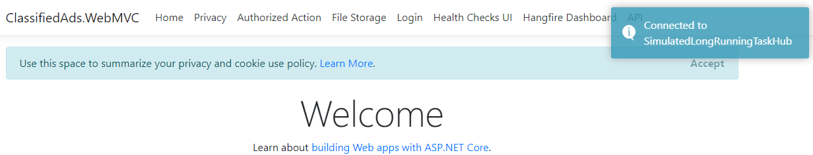

- Navigate to Health Checks UI https://localhost:44364/healthchecks-ui#/healthchecks and make sure everything is green.

  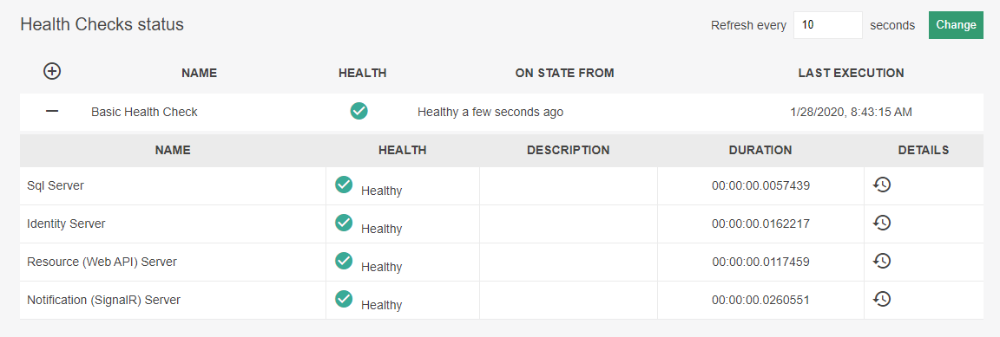

- Login on Identity Server:
  + Option 1: Use default created account:
    + User Name: phong@gmail.com
    + Password: v*7Un8b4rcN@<-RN
  + Option 2: Register new account at https://localhost:44367/Account/Register
  
  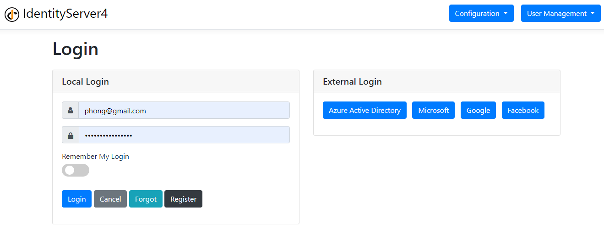

- Open Blazor Home Page at: https://localhost:44331

  Source, standalone build, and run instructions: [src/UIs/blazor](/src/UIs/blazor/README.md).

  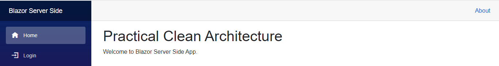

## How to Build and Run Single Page Applications:
- Angular:
  + Navigate to folder: [UIs/angular/](/src/UIs/angular/)
    ```
    npm install
    ng serve
    ```
  + Update [environment.ts](/src/UIs/angular/src/environments/environment.ts) & [environment.prod.ts](/src/UIs/angular/src/environments/environment.prod.ts) 
    ```ts
    export const environment = {
      OpenIdConnect: {
        Authority: "https://localhost:44367",
        ClientId: "ClassifiedAds.Angular"
      },
      ResourceServer: {
        Endpoint: "https://localhost:44312/api/"
      },
      CurrentUrl: "http://localhost:4200/"
    };
    ```
  + Go to http://localhost:4200/

    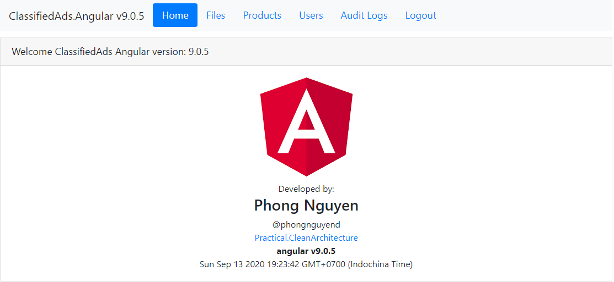
  
- React:
  + Navigate to folder: [UIs/reactjs/](/src/UIs/reactjs/)
    ```
    npm install
    npm run dev
    ```
  + Update [environment.dev.tsx](/src/UIs/reactjs/src/environments/environment.dev.tsx) & [environment.tsx](/src/UIs/reactjs/src/environments/environment.tsx) 
    ```js
    const environment = {
        OpenIdConnect: {
            Authority: "https://localhost:44367",
            ClientId: "ClassifiedAds.React"
        },
        ResourceServer: {
            Endpoint: "https://localhost:44312/api/"
        },
        CurrentUrl: "http://localhost:3000/"
    };
    export default environment;
    ```
  + Go to http://localhost:3000/
  
    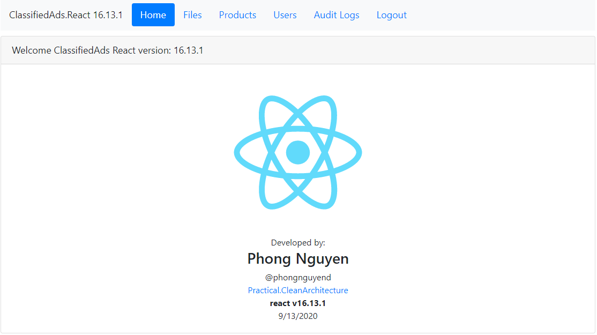
  
- Vue:
  + Navigate to folder: [UIs/vuejs/](/src/UIs/vuejs/)
    ```
    npm install
    npm run dev
    ```
  + Update [environment.dev.ts](/src/UIs/vuejs/environments/environment.dev.ts) & [environment.dev.ts](/src/UIs/vuejs/environments/environment.ts) 
    ```js
    const environment = {
        OpenIdConnect: {
            Authority: "https://localhost:44367",
            ClientId: "ClassifiedAds.Vue"
        },
        ResourceServer: {
            Endpoint: "https://localhost:44312/api/"
        },
        CurrentUrl: "http://localhost:8080/"
    };
    export default environment;
    ```
+ Go to http://localhost:8080/
  
    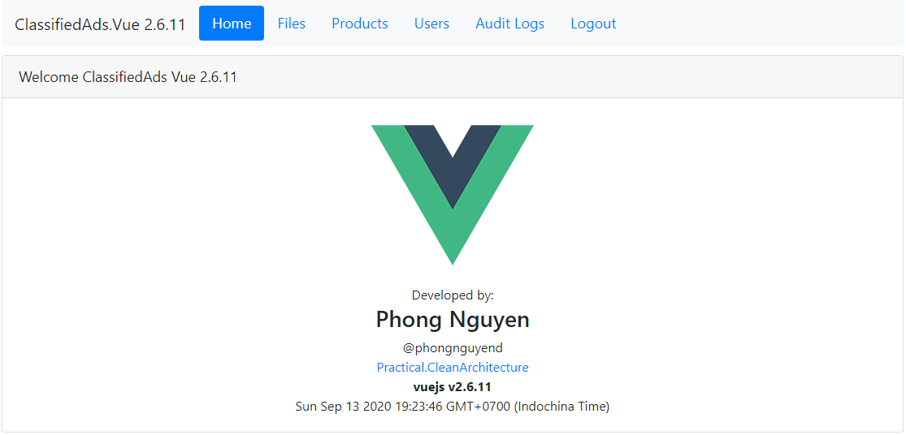

- Before Login, go to Identity Server https://localhost:44367/Client to make sure application clients have been registered:

  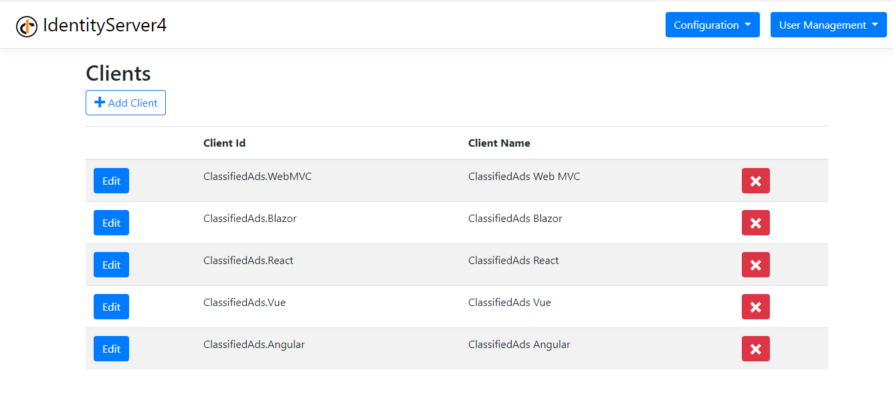
    
## How to Run on Docker Containers:
- Add Migrations if you haven't done on previous steps:
  + Install **dotnet-ef** cli:
    ```
    dotnet tool install --global dotnet-ef --version="8.0"
    ```
  + Navigate to [ClassifiedAds.Migrator](/src/Monolith/ClassifiedAds.Migrator/) and run these commands:
    ```
    dotnet ef migrations add Init --context AdsDbContext -o Migrations/AdsDb
    ```
- Navigate to [Monolith](/src/Monolith/) and run:
  ```
  docker compose build
  docker compose up
  ```
- Open Web MVC Home Page at: http://host.docker.internal:9003

  

- Navigate to Health Checks UI http://host.docker.internal:9003/healthchecks-ui#/healthchecks and make sure everything is green.

  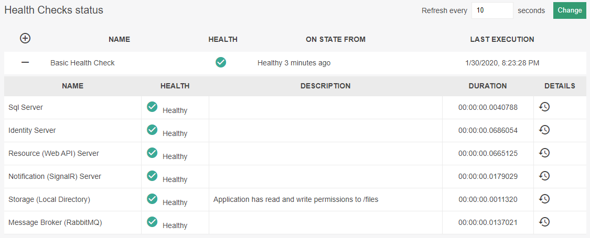

- Login on Identity Server:
  + Use default created account: phong@gmail.com / v*7Un8b4rcN@<-RN
  + Register new account at http://host.docker.internal:9000/Account/Register
  
- Open Blazor Home Page at: http://host.docker.internal:9008

  

## How to Run Integration & End to End Tests:

Start the API, Identity Server, and their required database/storage services. Use a development test account with permissions for the features being tested. PDF export tests also require the HTML-to-PDF service. The commands below use PowerShell and start from the repository root unless noted otherwise.

### API end-to-end tests (.NET)

Requires the .NET 10 SDK. Configure [appsettings.json](src/e2e/api/dotnet/ClassifiedAds.ApiIntegrationTests/appsettings.json) in the current API test project:

- `OpenIdConnect`: Identity Server authority, client ID/secret, and HTTPS metadata setting. The client must allow the password grant used by this suite.
- `WebAPI.Endpoint`: API origin, for example `https://localhost:44312` (without `/api/`).
- `Login`: test username, password, and API scope.

```powershell
dotnet test src/e2e/api/dotnet/ClassifiedAds.ApiIntegrationTests --logger trx
```

This suite writes product, configuration, file, and user records, exports/imports files, and requests confirmation/reset emails for its test user. Run it against a disposable test environment with a Fake email provider or test mail sink. Keep local credentials out of commits.

### API end-to-end tests (TypeScript)

Requires Node.js 22.13+; no browser installation is needed. Configure the ignored `.env` file with the API URL (including `/api/`), OIDC client credentials, and test account, or provide an access token.

```powershell
cd src/e2e/api/node
npm ci
Copy-Item .env.example .env # First-time setup; edit .env before running.
$env:API_ALLOW_WRITES = '1'
npm test
npm run report
```

Write scenarios require `API_ALLOW_WRITES=1`. Email scenarios additionally require `API_ALLOW_EMAILS=1` and `API_TEST_EMAIL`. PDF checks run by default; set `API_TEST_PDF=0` if the converter is unavailable. Set `API_IGNORE_HTTPS_ERRORS=1` only when testing local self-signed certificates. See the [TypeScript API test guide](src/e2e/api/node/README.md) for configuration, individual scenarios, cleanup, and reports.

### Web UI end-to-end tests

The shared scenarios support `angular`, `reactjs`, `vuejs`, `nextjs`, `bff-reactjs`, `blazor-server`, and `blazor-wasm`. Install the selected UI's dependencies and configure its backend/Identity Server URLs first. React and Next.js share a default port; BFF React also uses port 3000 for its frontend and shares browser port 44348 with Blazor WebAssembly, so run conflicting applications separately.

For **TypeScript Playwright**:

```powershell
cd src/e2e/ui/node/playwright
npm ci
npx playwright install chromium
Copy-Item .env.example .env # First-time setup; enter credentials and URLs.
$env:E2E_APPS = 'reactjs' # Select one app or a comma-separated list.
$env:E2E_START_SERVERS = '1'
npm run test:headed -- --project=reactjs
npm run report
```

Headed desktop browsers open maximized. `E2E_START_SERVERS=1` manages the selected UI servers; it does not start the API or Identity Server. Build the selected Blazor project first, as its managed start command uses `--no-build`. BFF React also requires its YARP proxy to be running. Use `E2E_START_SERVERS=0` for servers you start yourself. See the [TypeScript Playwright guide](src/e2e/ui/node/playwright/README.md) for application-specific setup and test selection.

For **.NET Playwright and Selenium**, start the selected UI yourself and use the .NET 10 SDK (plus Chrome for Selenium):

```powershell
Copy-Item src/e2e/ui/dotnet/.env.example src/e2e/ui/dotnet/.env
# Enter credentials and URLs in the ignored .env file.
$env:E2E_ENV_FILE = (Resolve-Path src/e2e/ui/dotnet/.env).Path
$env:E2E_APPS = 'reactjs'
dotnet build src/e2e/ui/dotnet/Playwright
powershell -File src/e2e/ui/dotnet/Playwright/bin/Debug/net10.0/playwright.ps1 install chromium
dotnet test src/e2e/ui/dotnet/Playwright --logger trx
dotnet test src/e2e/ui/dotnet/Selenium --logger trx
```

Both .NET runners use visible, maximized browsers by default; set `E2E_HEADLESS=1` for headless runs. See the [.NET UI test guide](src/e2e/ui/dotnet/README.md) for filters and reports.

For both web UI suites, set `E2E_ALLOW_WRITES=1` for CRUD and playground queue tests against a disposable backend, and `E2E_PDF=1` for PDF export. Playground queue tests require Fake notification providers. Blazor fixture creation/cleanup also requires `E2E_API_TOKEN`. Local self-signed browser certificates can be handled with `E2E_IGNORE_HTTPS_ERRORS=1`; server-side certificate trust must be configured separately.

### Mobile Android UI tests

Install the latest Flutter, Kotlin, React Native, MAUI, and Capacitor builds on one Android emulator/device and sign in to each app. Keep the API and Identity Server running, and start Metro on port 8081 for React Native debug builds. The runner tests installed apps; it does not rebuild them.

```powershell
./src/Mobiles/tests/Run-UiTests.ps1 -App All -Feature Home
./src/Mobiles/tests/Run-UiTests.ps1 -App All -Feature Navigation
# Run every default feature, or select one app:
./src/Mobiles/tests/Run-UiTests.ps1 -App All
./src/Mobiles/tests/Run-UiTests.ps1 -App Flutter -Feature Home
```

See the [mobile UI test guide](src/Mobiles/tests/README.md) for Android SDK/JDK setup, individual test methods, optional CRUD/PDF checks, and screenshots/reports. These UI Automator tests run on Android; they do not verify iOS.

## Application URLs:

https://github.com/phongnguyend/Practical.CleanArchitecture/wiki/Application-URLs

## Roadmap:

https://github.com/phongnguyend/Practical.CleanArchitecture/wiki/Roadmap

##

## Licence 🔑

This repository is licensed under the [MIT](/LICENSE) license.

### Duende.IdentityServer License 🔑

**Duende.IdentityServer** is available under both a **FOSS (RPL) and a commercial** license. 

For the production environment, it is necessary to get a specific license, if you would like more information about the licensing of **Duende.IdentityServer** - please check [this link](https://duendesoftware.com/products/identityserver#pricing).

The source code under [/src/IdentityServers/Duende](/src/IdentityServers/Duende) folder uses the source code from https://github.com/DuendeSoftware/IdentityServer.Quickstart.UI which is under the terms of the following
[**license**](https://github.com/DuendeSoftware/IdentityServer.Quickstart.UI/blob/main/LICENSE).

##
